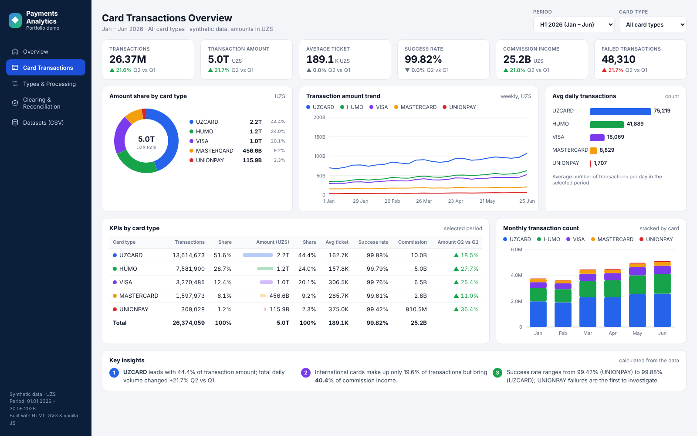
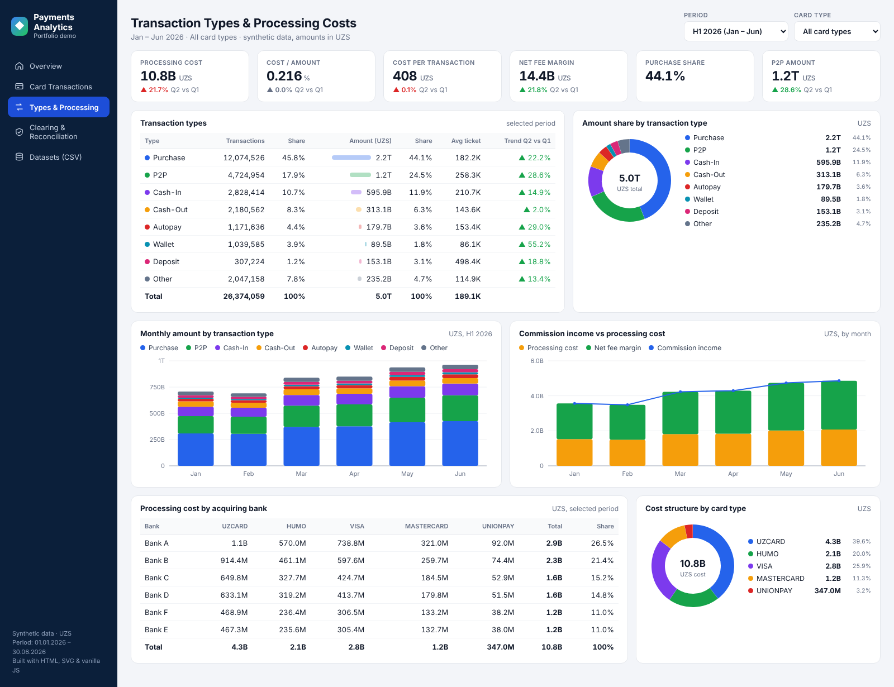
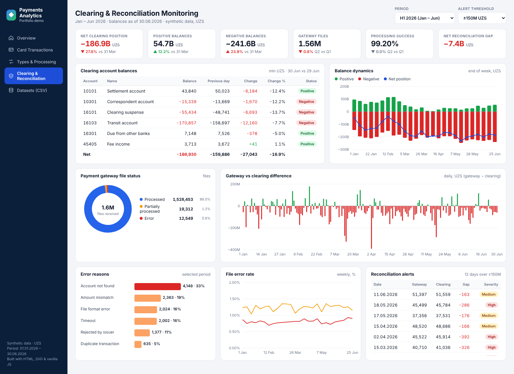

# Bank Clearing Dashboard

Payment and card-clearing analytics: three interactive dashboards, a PostgreSQL/SQL model and Power BI-ready datasets, built on fully synthetic data.

**Live demo:** https://dilshod1888.github.io/Bank_clearing_dashboard/



> **Important:** All data in this repository is synthetic and generated by scripts in this repo. No confidential banking, customer or production data is included. Bank names are placeholders (Bank A–F).

## Dashboards

| Dashboard | What it answers |
|---|---|
| [**Card Transactions Overview**](dashboards/cards.html) | How many transactions and how much volume per card type (UZCARD, HUMO, VISA, Mastercard, UnionPay)? Average ticket, success rate, commission, growth vs previous period. |
| [**Transaction Types & Processing Costs**](dashboards/processing.html) | What is the mix of Purchase / P2P / Cash-in / Cash-out / Wallet…? How much do we pay acquiring banks, and what is the net fee margin? |
| [**Clearing & Reconciliation Monitoring**](dashboards/reconciliation.html) | Which clearing accounts are negative today? Does the payment-gateway total match clearing? Which days breach the alert threshold, and why do files fail? |

Each page has period (H1 or a single month) and card-type filters, period-over-period deltas, hover tooltips and auto-generated insights.

<table>
<tr>
<td></td>
<td></td>
</tr>
</table>

## Key KPIs

| KPI | Definition |
|---|---|
| Transaction count / amount | Processed transactions and their value (UZS) |
| Average ticket | Amount ÷ count |
| Success rate | 1 − failed ÷ count |
| Commission income | Fees earned on card transactions |
| Processing cost | Fees paid to acquiring banks |
| Net fee margin | Commission income − processing cost |
| Net clearing position | Sum of clearing account balances (positive − negative) |
| Reconciliation gap | Payment-gateway amount − clearing amount, per day |
| File processing rate | Processed files ÷ received files |

SQL and DAX versions: [`sql/analytics_queries.sql`](sql/analytics_queries.sql) · [`powerbi/dax_measures.md`](powerbi/dax_measures.md)

## Architecture

```
scripts/build_dashboard_data.py  ──►  data/powerbi/*.csv        (fact tables for Power BI / PostgreSQL)
        (synthetic, seed 42)     └─►  dashboards/assets/data.js  (same data for the web dashboards)

data/generate_synthetic_data.py  ──►  transaction-level CSV  ──►  PostgreSQL  ──►  SQL analytics
```

The web dashboards are plain HTML + SVG + JavaScript with no external libraries, so they run from GitHub Pages or by opening the file locally.

## Datasets (`data/powerbi/`)

| File | Grain | Rows |
|---|---|---|
| `fact_card_transactions_daily.csv` | date × card type × transaction type | 7,240 |
| `fact_processing_cost_monthly.csv` | month × bank × card type | 180 |
| `fact_account_balance_daily.csv` | date × clearing account | 1,086 |
| `fact_gateway_reconciliation_daily.csv` | date | 181 |
| `fact_gateway_errors_daily.csv` | date × error reason | 1,086 |

## Quick Start

```bash
# Rebuild the dashboard datasets (no third-party packages needed)
python scripts/build_dashboard_data.py

# Open the dashboards
open dashboards/index.html          # or: python -m http.server, then /dashboards/

# Transaction-level data for the PostgreSQL model
python data/generate_synthetic_data.py --rows 50000 --seed 42
psql -d clearing_db -f sql/create_schema.sql
psql -d clearing_db -c "\copy clearing_transactions FROM 'data/synthetic_clearing_transactions.csv' CSV HEADER"
psql -d clearing_db -f sql/analytics_queries.sql

# Refresh screenshots (needs: pip install playwright && playwright install chromium)
python scripts/screenshot_dashboards.py
```

## Repository Structure

```
Bank_clearing_dashboard/
├── dashboards/    # Interactive HTML dashboards (index, cards, processing, reconciliation)
├── data/          # Generators, sample CSV, Power BI fact tables (data/powerbi)
├── sql/           # PostgreSQL schema and analytical queries
├── powerbi/       # Power BI guide and DAX measures
├── docs/          # Business requirements
├── scripts/       # Dataset builder and screenshot tool
└── images/        # Dashboard screenshots
```

## Technologies

**SQL · PostgreSQL · Power BI (DAX) · Python · JavaScript / SVG**

## Portfolio Value

Demonstrates financial data analytics for payments and clearing: KPI design, data modelling, reconciliation logic, and building executive dashboards that management and operations teams can use daily.
